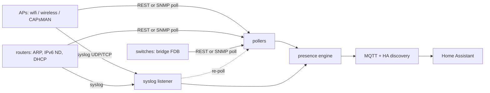

# mikrotik-presence-sensor

Home Assistant presence detection based on your MikroTik network. People are
**home** while one of their phones' MAC addresses can be seen on your MikroTik
gear:

- **Wi-Fi registration tables** of access points, for both the RouterOS 7 `wifi`
  package and the legacy `wireless` package, including CAPsMAN controllers.
- **ARP** and **IPv6 neighbor** tables of routers.
- **Bridge host (FDB)** tables of switches.
- **DHCP leases** (as a weak "seen recently" signal).
- **Live logs** that the devices send over syslog (UDP and TCP). Arrivals show
  up within a second. Departures are confirmed by an immediate re-poll.

Devices are polled over the **REST API (HTTPS)** or **SNMP v2c/v3**, chosen per
device. State is published over **MQTT** with **Home Assistant discovery**, so
no HA integration needs to be installed. Each person gets a `device_tracker`
and a presence `binary_sensor`, with attributes for AP, interface, SSID,
signal and IP addresses.

The sensor is built **IPv6-first**. It listens dual-stack by default, talks to
devices and brokers over IPv6 literals or names, polls the IPv6 neighbor
cache, and lists IPv6 addresses first. It runs as a small static binary in a
distroless container with a Docker healthcheck and exposes
**Prometheus metrics**. It reconnects to the broker on
its own and republishes everything after an outage.



## Quick start (Docker Compose)

1. **Prepare RouterOS.** On each device, create a read-only user and enable
   HTTPS (or SNMP), then point remote logging at the sensor. The scripts are
   in [`examples/routeros/`](examples/routeros), and the walkthrough is in
   [docs/mikrotik-setup.md](docs/mikrotik-setup.md).
2. **Configure.**
   ```sh
   cp examples/config.yaml config.yaml   # or examples/config.minimal.yaml
   $EDITOR config.yaml                   # broker, devices, people
   ```
3. **Run.**
   ```sh
   docker compose up -d --build          # with an existing broker
   docker compose --profile broker up -d # also start a local Mosquitto
   docker compose ps                     # STATUS shows (healthy)
   curl -s 'http://[::1]:8080/status'    # live diagnostics
   ```
4. **In Home Assistant**, with the MQTT integration set up, the devices
   "*Alice presence*" etc. appear automatically. Assign
   `device_tracker.alice_presence` to the person "Alice". See
   [docs/home-assistant.md](docs/home-assistant.md).

> **Important: phones must use their real MAC address on your home Wi-Fi.**
> iOS ("Private Wi-Fi Address") and Android ("Use randomized MAC") hide it by
> default. Turn that off for the home network, or use the per-network address
> the phone shows for your SSID. The sensor warns at startup about any
> configured MAC that looks randomized.

## Minimal configuration

```yaml
mqtt:
  broker: "tcp://[2001:db8:0:10::5]:1883"
defaults:
  rest:
    username: presence
    password: change-me
    insecure_skip_verify: true   # use ca_file in production
devices:
  - name: ap1
    host: 2001:db8:0:10::2
people:
  - id: alice
    macs: ["AA:BB:CC:00:00:01"]
```

### …or environment variables only

Every setting can be set as an `MPS_*` variable, either in place of the YAML
file or on top of it. The variable name is the uppercased path, and list items
take an index:

```sh
MPS_MQTT_BROKER=tcp://[2001:db8:0:10::5]:1883
MPS_DEFAULTS_REST_USERNAME=presence
MPS_DEFAULTS_REST_PASSWORD_FILE=/run/secrets/routeros
MPS_DEVICES_0_NAME=ap1
MPS_DEVICES_0_HOST=2001:db8:0:10::2
MPS_PEOPLE_0_ID=alice
MPS_PEOPLE_0_MACS=AA:BB:CC:00:00:01,AA:BB:CC:00:00:02
```

The complete reference, with every key, variable and default, is in
[docs/configuration.md](docs/configuration.md). `examples/env.example` is a
ready-to-use `.env` file.

## How presence is decided

- A person is **home** as soon as any of their MACs has a *current sighting*.
  That means it appears in the latest poll of an enabled table, or in a recent
  log event.
- When the last sighting goes away, a **`consider_home`** timer starts (3
  minutes by default). The person becomes **not_home** only when the timer
  expires. This absorbs roaming between APs, phones dozing off, and missed
  polls.
- ARP and neighbor entries count only in fresh states (`reachable`, `delay`,
  `probe`). Stale cache entries outlive a departed phone by a long time.
- When a device fails to poll several times in a row, its last data is
  dropped. Nobody stays "home" because an AP went offline.
- After a restart people are `unknown` and nothing is published until they
  are seen, or until `consider_home` has passed. This way a restart doesn't
  trigger "left home" automations.

The details, including the state machine, are in
[docs/architecture.md](docs/architecture.md).

## Endpoints and commands

| | |
|---|---|
| `GET /healthz` | liveness; 503 while MQTT is down (unless `health.require_mqtt: false`) |
| `GET /readyz` | 200 once MQTT is connected and a device has been polled |
| `GET /status` | JSON: every person with observations, every device's poll status, syslog counters |
| `GET /metrics` | Prometheus metrics: device availability, per-table poll latency, discovered items per kind, syslog event rates ([docs](docs/metrics.md)) |
| `mikrotik-presence-sensor -check-config` | validate and print the effective config (secrets masked) |
| `mikrotik-presence-sensor healthcheck` | probe `/healthz`; used by the Docker `HEALTHCHECK` |
| `mikrotik-presence-sensor -version` | print the version |

## Logging

Logs are structured, using [zorplogger](https://github.com/endreszabo/zorplogger)'s
Zorp-style format by default:

```
2026-11-16T23:25:30+01:00 engine.info(n/a): person arrived; person='alice', via='[wifi]', device='ap1'
2026-11-16T23:25:30+01:00 syslog.info(c4bbf3cf): presence event; event='leave', mac='aa:bb:cc:dd:ee:01', device='ap1', iface='wifi1', kind='wifi'
```

The ID in parentheses ties together all lines of one poll cycle or one syslog
TCP connection. Set `log.format: json` (`MPS_LOG_FORMAT=json`) to get plain
JSON lines instead.

## Building from source

Go 1.26.5 or newer is required.

```sh
make build        # ./mikrotik-presence-sensor
make race         # unit tests with the race detector
make test-broker BROKER='tcp://[::1]:1883'   # MQTT integration test
make docker       # container image
```

## Documentation

- [Configuration reference](docs/configuration.md)
- [MikroTik setup](docs/mikrotik-setup.md): users, certificates, SNMP, remote logging
- [Home Assistant](docs/home-assistant.md): entities, attributes, automations
- [Prometheus metrics](docs/metrics.md): metric reference, queries, alert rules
- [Architecture](docs/architecture.md): data flow and presence state machine
- [Troubleshooting](docs/troubleshooting.md)
