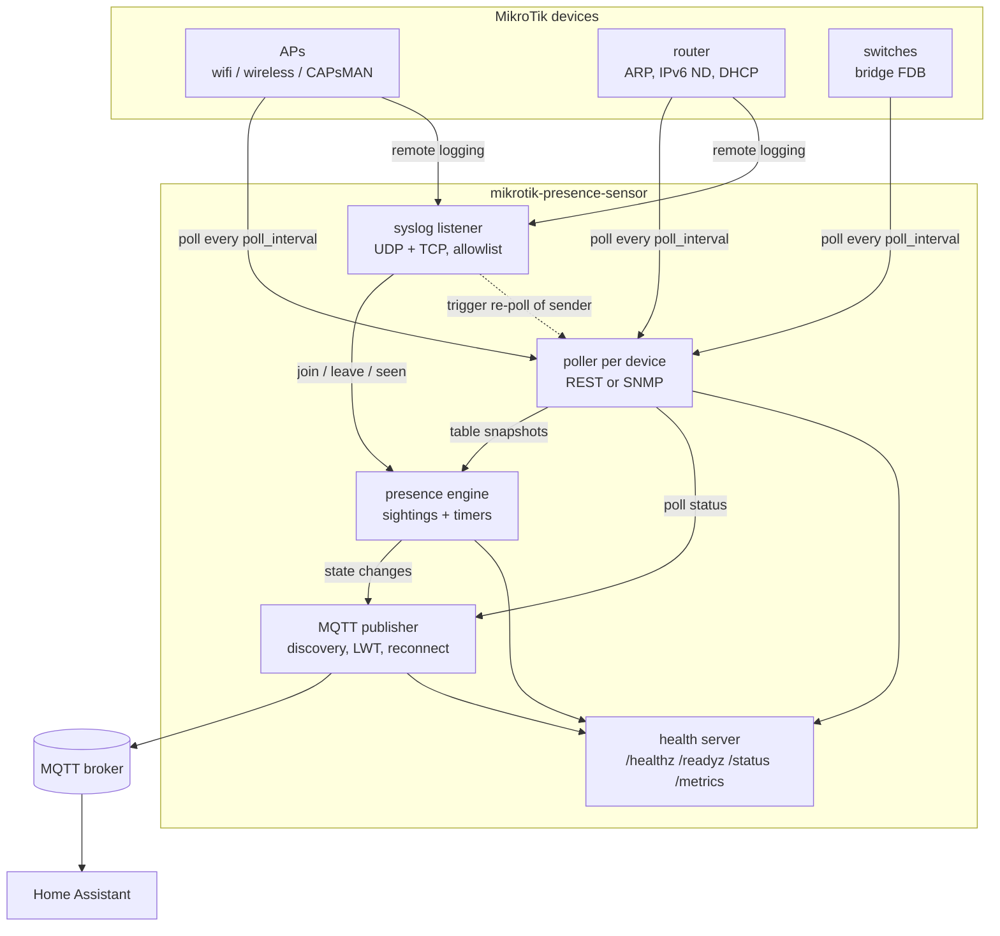
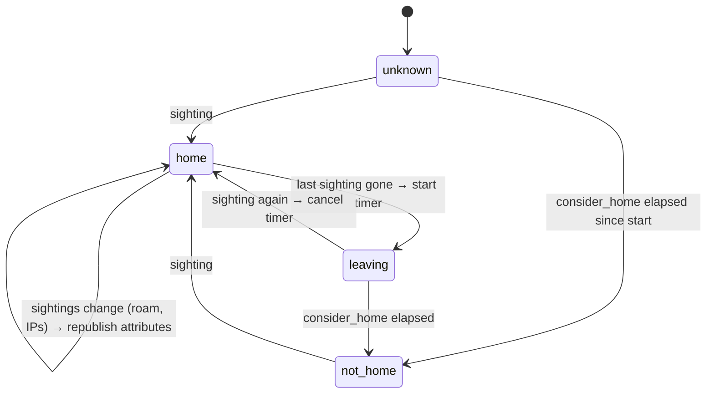

# Architecture

## Packages

| package | role |
|---|---|
| `internal/config` | one struct tree with `yaml` and `env` tags: defaults → YAML → env, then merge, secret files, validation |
| `internal/mikrotik` | `Kind`, `Observation`, the `Client` interface, RouterOS duration parsing |
| `internal/mikrotik/rest` | REST client (TLS ≥ 1.2, basic auth, `.proplist`), one endpoint per kind |
| `internal/mikrotik/snmp` | gosnmp client (v2c/v3) that walks IF-MIB, IP-MIB, (Q-)BRIDGE-MIB and MIKROTIK-MIB tables |
| `internal/poller` | per-device loop: jitter, interval, backoff, debounced triggers, unsupported-kind pruning, stale invalidation |
| `internal/syslog` | listeners, RFC 3164/5424 header stripping, RFC 6587 framing, regex rules, source attribution |
| `internal/presence` | sighting store and the per-person state machine |
| `internal/mqtt` | paho client, HA discovery payloads, state publishing, stale discovery cleanup |
| `internal/health` | HTTP endpoints and the `healthcheck` probe client |
| `internal/metrics` | Prometheus collectors fed by poller reports, syslog observer and engine changes |
| `internal/logging` | zorplogger or JSON `slog` handler |

## Sightings

The engine keeps two kinds of sightings.

- **Snapshots.** Each poller delivers the full table for each `(device, kind)`
  it polls. A new snapshot replaces the previous one. A MAC is current while
  it appears in the latest snapshot. Filters still apply: ARP and neighbor
  entries only count in the configured states, and DHCP leases only within
  `event_ttl` of their `last-seen`.
- **Events** come from syslog rules.
  - `join` stays current until a `leave` arrives for the same MAC and device,
    or until a newer snapshot of that `(device, kind)` no longer contains the
    MAC. That second case covers lost "disconnected" messages.
  - `seen` stays current for `event_ttl`.
  - `leave` deletes the matching event. It also removes the MAC from that
    device's Wi-Fi snapshots right away, without waiting for the next poll.

After repeated poll failures (`stale_after_failed_polls`), a snapshot is
dropped, so an unreachable AP can't keep people at home.

## Per-person state machine

- `unknown` is internal and never published, so a restart leaves the retained
  HA state untouched until the sensor knows better.
- `leaving` is also internal; it publishes `home` while the timer runs. This
  absorbs AP roaming, phones sleeping, and the gap between a disconnect event
  and the next poll.
- Expiring sightings (`seen` events, DHCP) arm a per-person timer that
  re-evaluates the person when they lapse.

## Concurrency

- Each poller runs in its own goroutine, as do the syslog listeners (one per
  TCP connection, at most 64), the MQTT client, and the health server. All of
  them run under one `errgroup`, which `SIGINT`/`SIGTERM` cancels.
- The engine serializes everything behind a mutex. It calls change listeners
  (MQTT) *after* releasing the lock. Pollers likewise call into the engine
  outside their own lock. No path re-enters a lock it holds.

## MQTT resilience

- paho runs with `AutoReconnect` and `ConnectRetry`, and backs off up to
  `max_reconnect_interval`. The process starts and works without a broker.
- The LWT (`offline`, retained) marks every entity unavailable if the process
  dies.
- Publishes made while disconnected are skipped, not queued. Every
  (re)connect publishes availability, discovery, all person states, all
  device states, and the bridge summary. HA ends up with the current truth,
  not a backlog.
- Subscriptions (`homeassistant/status`) are renewed on each connect because
  the session is clean.
- `/healthz` reports 503 while disconnected, so Docker shows the container as
  unhealthy during long outages. Set `health.require_mqtt: false` to turn
  that off.

## IPv6

- Every listener defaults to `[::]` (dual-stack). IPv4-mapped senders are
  unmapped before allowlist checks.
- Hosts are joined with `net.JoinHostPort`, so IPv6 literals work for REST,
  SNMP (`udp`), and MQTT URLs (`tcp://[2001:db8::5]:1883`).
- DNS names resolve to all address families. Go's dialer uses Happy
  Eyeballs.
- Neighbor-cache polling gets the same support as ARP. The SNMP path decodes
  `ipNetToPhysicalTable`'s typed `InetAddress` index for v4 and v6.
- `ip_addresses` attributes list global IPv6 first, then link-local, then
  IPv4.
- The healthcheck probes `::1` first and falls back to `127.0.0.1` for
  containers without IPv6.
